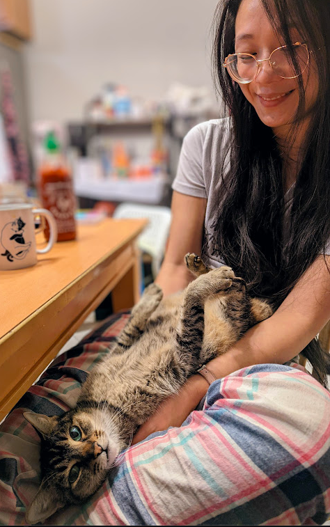
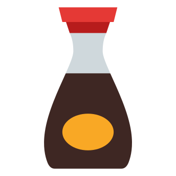

---
hide:
  - footer
---

# About

  

## {  width="25" }Bio

Stephanie Isan (she/they) is the pen name of a queer Taiwanese American writer and software engineer from the San Francisco Bay Area. 

Their work has been distinguished in the Best American Short Stories and is published and/or forthcoming in: *AGNI*, *Joyland Mag*, *Five Points*, *The Bellevue Literary Review*, *Split Lip*, *The Masters Review*, and others. She is currently an Assistant Poetry Editor at [Barrelhouse Mag](https://www.barrelhousemag.com/about) and a Prose MFA candidate at the University of Massachusetts, Amherst. She is a Kundiman fellow.

They currently live with two cats, one beagle mix, and her husband <s>in an Asian pear tree</s> in the northeastern US. Stephanie is at work on a novel and a short story collection.

## {  width="20" }Credits

#### Photo
&nbsp; Credit demanded by: Husbando  :fontawesome-solid-heart:{ .heart }

#### Site 
&nbsp; Made with: [Material for mkdocs](https://squidfunk.github.io/mkdocs-material/)

#### Icons 
&nbsp; Yoinked from: <a target="_blank" href="https://icons8.com">Icons8</a>

