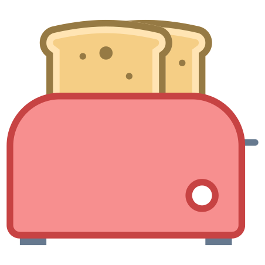
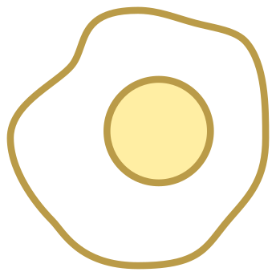

---
hide:
  - footer
---

# Publications & Honors 

## {  width="20" }Publications

### Fiction  
- **"Hulijing"** in [The Masters Review](https://mastersreview.com/
winter-short-story-award-honorable-mention-hulijing-by-stephanie-isan/) (Aug 2026)
    - Honorable Mention, [The Masters Review Winter Short Story Award 2025-2026](https://mastersreview.com/2025-2026-winter-short-story-award-for-new-writers-finalists/) 
- **"How to Make Non-Korean Kimchi"** in [Split Lip](https://splitlipthemag.com/fiction/1125/stephanie-isan) (Nov 2025)
    - Distinguished in [The Best American Short Stories 2026](https://www.harpercollins.com/products/the-best-american-short-stories-2026-viet-thanh-nguyennicole-a-lamy?variant=44759133749282)
- **"The Real Chupa Chup"** in [Five Points](https://fivepoints.gsu.edu/issue/five-points-vol-24-no-1/) (May 2025)
    - Distinguished in [The Best American Short Stories 2026](https://www.harpercollins.com/products/the-best-american-short-stories-2026-viet-thanh-nguyennicole-a-lamy?variant=44759133749282)
- **"Hey, Cam Club"** in [Joyland Magazine](https://joylandmagazine.com/fiction/hey-cam-club/) (May 2024)
- **"The Last Thing She Touched"** in [The Bellevue Literary Review](https://blreview.org/table-of-contents/issue-45/) (Oct 2023)
- **"Chinese Mermaids"** in [jmww](https://jmwwblog.wordpress.com/2022/11/23/flash-fiction-chinese-mermaids-by-stephanie-isan/) (Nov 2022)
    - Longlisted, [Wigleaf, Top 50](https://wigleaf.com/2023longlist.htm)

### Poetry
- **"Wild Caught"** in [AGNI](https://agnionline.bu.edu/about/the-journal/archive/agni-104/) (Oct 2026)
- **"Unsung"** in [Epiphany](https://epiphanyzine.com/features/2023/8/8/unsung-by-stephanie-isan) (Aug 2023)
- **"Spring Rituals"** in [Frontier Poetry](https://www.frontierpoetry.com/2022/03/04/poetry-stephanie-isan/) (March 2022) 
    - Finalist, [Palette Poetry 2021 Prize](https://www.palettepoetry.com/2021/11/09/winners-and-finalists-for-the-2021-palette-poetry-prize/)
    - Longlisted, [Frontier Award for New Poets 2021](https://www.frontierpoetry.com/2021/12/13/2021-anp-winners-finalists/)

---

## {  width="20" }Honors

### Fellowships & Workshops
- [Kundiman](http://www.kundiman.org/), Fiction 
- [The Juniper Institute 2026](https://juniperinstitute.umasscreate.net/), Institute Fellow 
- [The Kenyon Review Writers Workshop 2026](https://kenyonreview.org/adult-writers/), Fiction 
- [Tin House Summer Workshop 2024](https://mccormackwritingcenter.org/oregon-summer-workshop/), Fiction 
- [Tin House Winter Workshop 2024](https://mccormackwritingcenter.org/winter-workshop/), Fiction 

### Other 
- **Winner**, [Deborah Slosberg Award in Fiction 2026](https://www.umass.edu/english/book/mfa-program-annual-awards), judged by Kristen Arnett, for "Barn Burning" 
- **Runner Up**, [Harvey Swados Prize in Fiction 2026](https://www.umass.edu/english/book/mfa-program-annual-awards), judged by Juan Martinez, for "Barn Burning"

---

## {  width="20" }Invited Talks & Press

- **Selected Reader** at Live Lit, [UMass-Amherst Literary Arts Festival](https://www.umass.edu/english/events/2026-literary-arts-festival) (2026)
- **Honors Speaker** at Greenfield Community College: ["Creative Writing in the Age of AI"](https://www.gcc.mass.edu/events/creative-writing-in-the-age-of-ai/) (2026)
- **Panelist** at [5PAN @ Smith College](https://docs.google.com/document/d/1TzGk2r_ick3yKcyPOCKqThs8UEtTqiZNzeYc7f7z5-M) for *Asian American Feminist Pedagogies for Collective Care and Social Change* (2025)
- **Interviewed** in [The Bellevue Literary Review](https://blreview.org/recent-news/blr-fall-2023-theartoftakingcare/): *The Art of Taking Care — an Evening with Writers and Caregivers* (2023)

